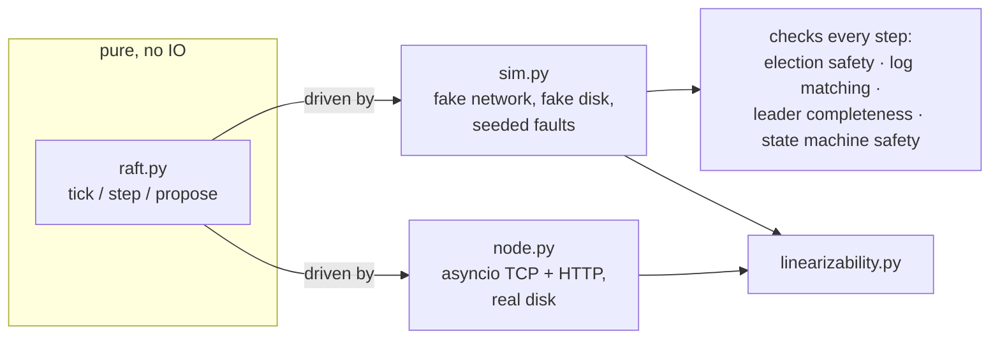

# quorum

[](https://github.com/servanklc93-cmd/quorum/actions/workflows/test.yml)


A replicated key-value store built on Raft, in pure Python with no dependencies.

It comes with two testing tools: a deterministic simulator that throws partitions,
crashes and lost messages at the cluster, and a linearizability checker that verifies
what the clients saw.


```bash
pip install -e .
quorum cluster &              # three nodes on localhost
quorum put city Lisbon
quorum get city               # Lisbon
quorum status
python -m quorum.sim --seeds 1000
```

## What's in it

- **Raft** ([the paper](https://raft.github.io/raft.pdf)): leader election, log
  replication with fast conflict backup, snapshots and log compaction, plus two
  extensions from etcd. *PreVote* keeps a node that rejoins from bumping the term and
  deposing a healthy leader. *CheckQuorum* makes a leader that can't reach a majority step
  down.
- **Key-value state machine:** `get`, `put`, `delete`, `cas`. Reads go through the log,
  so they are linearizable. Client sessions (client id + sequence number) make retries
  exactly-once.
- **A real server:** asyncio, TCP between nodes, a small HTTP API for clients, a durable
  log with a CRC per record and fsync before every acknowledgement.
- **A deterministic simulator** that runs the same Raft code over a hostile fake network.
  Every run is reproducible from its seed.
- **A linearizability checker** (Wing & Gong search with memoisation, as in Knossos and
  Porcupine) that verifies client histories, both from the simulator and from real
  processes.

## How it's built



The Raft core is a state machine with no sockets, no clock and no threads, the same
design as etcd's raft library:

```python
node.tick()              # one unit of time passes
node.step(message)       # a message arrived
node.propose(command)    # leader only
node.take_messages()     # what it wants sent
node.take_committed()    # entries to apply, in order
```

The production server and the simulator both drive this same object. That is what makes
deterministic simulation possible: inside the simulator, timeouts, message delays, drops,
duplicates, partitions and crashes all come from one seeded random generator. When a seed
fails, `python -m quorum.sim --start <seed> --seeds 1` replays the exact same run.

## Testing

### The simulator

After every step the simulator checks Raft's four safety properties:

| property | means |
|---|---|
| election safety | at most one leader per term |
| log matching | if two logs agree on the term at some index, they're identical up to there |
| leader completeness | a newly elected leader has every entry committed before it |
| state machine safety | every node applies the same command at the same index |

At the end of a run it heals the network and requires *liveness*: every outstanding
request completes and all nodes converge. Then the whole client history goes through
the linearizability checker.

1,000 seeds take about 90 seconds, and here is what they put the code through:

| | |
|---|---:|
| leader elections | 39,167 |
| crashes (disk kept, memory lost) | 188,318 |
| network partitions | 11,752 |
| messages sent / dropped | 10.6M / 878k |
| client operations completed and checked | 362,332 |
| snapshots installed on lagging followers | 132,675 |

### Testing the tests

A simulator that never fails proves nothing unless it can fail. So eight classic Raft
bugs were planted one at a time:

| planted bug | caught by |
|---|---|
| a candidate's log isn't checked when voting | simulator: leader completeness |
| a vote isn't written to disk before answering | simulator: election safety (two leaders in one term) |
| voting twice in the same term | simulator: election safety |
| a follower skips the `prev_index` / `prev_term` check | simulator: log matching |
| conflicting entries are kept instead of truncated | simulator: crash in the follower |
| a leader ignores a higher term | simulator: liveness (never converges) |
| client sessions turned off | simulator: linearizability |
| **committing an old-term entry by counting replicas ("figure 8")** | **only the scripted test** |

Most of that table didn't come for free. The first version of the simulator used a
single fixed configuration, and three of these bugs went straight through it:

- **PreVote was masking a bug.** With the log check removed from real votes, PreVote still
  checks it, so the broken vote path never runs. The fix was *swarm testing*
  (Groce et al., 2012): every seed now picks its own cluster size (3, 5 or 7 nodes),
  turns PreVote and CheckQuorum on or off, and picks its own fault rates, from calm to
  brutal.
- **The fake disk was too kind.** A bug that set `voted_for` without saving it survived a
  simulated crash, because the in-memory storage kept the field anyway. Now a crash
  only keeps what went through `save_hard_state`.
- **Random crashes rarely land where it matters.** A double vote needs a node to crash
  *right after* it voted and come back before the term ends. So the simulator now also
  "buggifies" (the FoundationDB term): it crashes a node at risky moments, right after
  a vote or an append, and restarts it a few ticks later.

Figure 8 from the Raft paper needs such a specific sequence of leaders and partial
replication that 5,000 random seeds never produced it. `test_figure_8_from_the_paper`
replays the paper's scenario message by message instead, and catches the bug.

### Bugs found along the way

- **No flow control** (found by the simulator). Every append response triggered another append right away, even
  when it carried no new information. Each heartbeat started a new chain of messages
  that never died out while a follower was behind, and duplicated messages multiplied
  the chains. One seed reached 2,000 messages per tick. Now only a response that moves
  `match_index` forward, or moves `next_index` back, sends anything immediately.
- **A pre-vote refusal carried the wrong term** (found reviewing the code, before the
  simulator existed), so a refused candidate still bumped its term. That is exactly the
  disruption PreVote exists to prevent.

### Real processes, Jepsen-style

`tests/test_cluster.py` starts three real nodes as subprocesses. It writes data, kills
the leader with `SIGKILL`, checks that a new leader takes over with nothing lost, then
restarts the dead node from its disk and waits for it to catch up.

The last test runs four client threads, each sending every request to a random node,
while the leader is killed twice. Every operation is recorded with real timestamps.
Operations whose outcome is unknown stay open-ended. The checker then has to find a
valid linearization. A planted bug where nodes answer reads from their local copy
instead of the log fails this test in 4 out of 4 runs.

Writing this test turned up a client bug: one TCP connection per request left
thousands of sockets in `TIME_WAIT`, and macOS ran out of ephemeral ports within
seconds. The client now keeps one connection per node.

```bash
pip install -e ".[dev]"
pytest                               # 45 tests, ~75 s (300 simulation seeds included)
python -m quorum.sim --seeds 10000   # as many as you like
```

## HTTP API

| request | |
|---|---|
| `GET /kv/<key>` | `{"value": ...}`, a linearizable read |
| `PUT /kv/<key>` | body is the value |
| `DELETE /kv/<key>` | `{"deleted": true/false}` |
| `POST /kv/<key>/cas` | `{"expected": ..., "value": ...}` → `{"ok": ...}` |
| `GET /status` | role, term, leader, commit / applied index |

A follower answers `307` with the leader's address. `503` means there is no leader at
the moment. `504` means the request's outcome is unknown: retry it with the same
`X-Client-Id` and `X-Seq` headers and it won't be applied twice.

## Limits

- No membership changes: the cluster's nodes are fixed at start.
- Reads go through the log. ReadIndex or leader leases would make them cheaper.
- Each append fsyncs on its own, with no batching across requests, so write
  throughput is bounded by the disk.
- No authentication or TLS, so run it on a trusted network.

## Layout

```
quorum/
  raft.py              the algorithm: elections, replication, snapshots, PreVote, CheckQuorum
  storage.py           durable term / vote / log / snapshot (memory and file versions)
  kv.py                the key-value state machine with client sessions
  linearizability.py   the checker
  sim.py               the deterministic simulator
  node.py              asyncio server: peer TCP, client HTTP
  client.py, cli.py    client library and command line
tests/                 raft scenarios (figure 8), storage, checker, simulator, real cluster
```

## License

MIT
